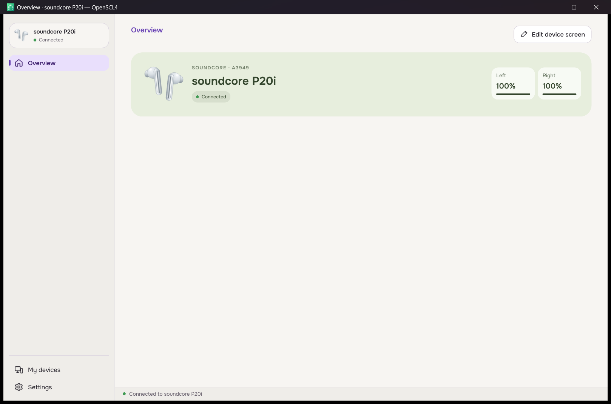
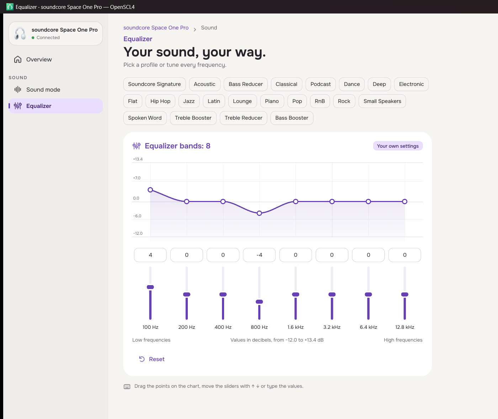

# OpenSCL4 2.0 desktop shell

The desktop app is the **OpenSCL4 2.0 desktop shell**: the product keeps the
OpenSCL4 name, and the UI is **vendored from OpenSCL4** under GPL-3.0; it is not
a new design. The Slint tree in `ui/` comes from
`D:\Projects\OpenSCL4\desktop\ui` at commit `01276e08` and keeps the upstream
layout, components, pages, icons, fonts and art.

## Status

- The shell compiles and opens; the window title still says OpenSCL4.
- The app is built as crate version `2.0.0`, and `AppState.app-version` is
  filled from that crate version, so the About section says
  “OpenSCL4 2.0.0”.
- The vendored **Add Device** dialog is populated from the model catalog
  (`core/crates/models/src/catalog.rs`) through `src/catalog_adapter.rs`: all
  39 supported models as cards with their name, code and device art.
- The existing category chips filter by form factor: **All**, **Earbuds**
  (TWS and sleep buds — the vendored UI has no Sleep chip), **Over-ear**,
  **Open-ear** and **Speakers**. The search field filters by model name or code.
- Choosing a model advances the existing dialog to its paired-device step with
  that model's name, code and art. The step lists the Windows-paired Soundcore
  candidates for that model — devices that advertise the model's Soundcore
  vendor RFCOMM service, or the standard SPP service when the model has none —
  and marks the likely match with “looks like the chosen model”.
- The MVP connects to real paired devices over classic Bluetooth RFCOMM. The
  Windows transport (`src/transport_windows.rs`) opens the model's vendor
  service with the standard SPP fallback; the session
  (`core/crates/session`) writes the `01 01` state request and parses the
  answer, and writes the measured A3062 `06 81` sound-mode, `03 87` equalizer
  and remaining-settings frames; **Overview** then shows the connected device's
  name, code and battery tiles (`src/controller.rs`).
- Battery tiles are left/right for the TWS models. Single-battery models show
  one whole-device tile on their own step scale, e.g. a raw `2/10` reads `20 %`.
- The **Sound mode** page is implemented for the models the core measures a mode
  for — today the Space One Pro (A3062). On connect the page shows the device's
  current mode (noise canceling, transparency or normal); choosing a tile writes
  one `06 81` mode frame, then re-reads the `01 01` state (skipping the mode
  acknowledgement) and selects the mode the device reports. A model without a
  measured sound mode, e.g. the P20i (A3949), gets no Sound mode page and no
  mode frame.
- The **Equalizer** page is implemented for the models the core reports an
  equalizer for — today the Space One Pro (A3062). On connect the page shows the
  device's current preset and its curve: the 22 catalog presets as chips (the
  current one checked) and the eight visible band values in the measured
  −12.0…+13.4 dB range on the vendored chart. Choosing another chip writes one
  `03 87` preset frame, then re-reads the `01 01` state and selects the preset,
  its name and its curve from what the device reports.
- The eight A3062 bands are **editable**, so the page is not read-only: each
  band has a value field and a slider, and there is a Reset button. Dragging a
  chart point or a slider previews the curve locally and writes nothing; letting
  go, or pressing Enter in a field, writes one `03 87` custom frame (`0xFEFE`
  and the eight visible values, the rest of the measured body copied from the
  last re-poll) and then re-reads the `01 01` state, so the chart, the name tag
  (“Your own settings”) and the fields follow the device. Reset writes a flat
  custom curve. Built-in preset chips still work and switch the device away
  from a custom curve and back.
- **Saved equalizer profiles** are implemented for the editable A3062 page: the
  vendored **My profiles** panel and its **Save profile** dialog, row list and
  delete confirmation are wired. Saving stores the eight current bands under a
  name; a saved row shows the profile's curve thumbnail, “Bands: 8” and an
  **Applied** tag while the device's bands are exactly the profile's. Clicking a
  row applies it as one custom `03 87` frame (`0xFEFE` and the profile's eight
  bands) followed by a `01 01` re-poll, so the chart, fields and Applied tag
  follow the device. The row menu's **Delete** removes the profile after the
  confirmation dialog. Profiles persist across restarts in
  `%APPDATA%\OpenSCL4\equalizer-profiles.json` (schema v1, written atomically
  through a temporary file and a rename); the file is loaded at startup, and a
  missing, unreadable or invalid document starts empty and is logged to stderr
  instead of crashing. A duplicate name asks before replacing, an empty or
  whitespace-only name is rejected with a dialog message, and out-of-range bands
  are clamped by the page's edits to the measured range and rejected by the core
  model and on document load before they can be stored. A save or delete whose
  document cannot be written is not silent: the failed change is rolled back (the
  list and the file stay as they were), the page error banner says
  “Could not save equalizer profiles” and the reason is also logged to stderr.
- **Profile import** is implemented in that panel: **Paste** reads the Windows
  clipboard and **Open file** opens a native JSON picker (files over 1 MiB are
  refused). A parseable OpenSCL4 transfer-profile document opens the vendored
  **Import profiles** dialog with one row per profile — **New**, **Replaces**
  (a saved profile has the same name), and the blocking **wrong band count** and
  **out of range** statuses — plus a red note and a disabled **Import** button
  when anything is blocked. Confirming re-validates the whole file all-or-nothing
  and merges it into the saved profiles (same-named profiles are replaced),
  writes the document and closes the dialog with the **Imported** note and toast;
  blocked files write nothing and leave the dialog open. A parse failure shows
  “This is not an equalizer profiles file” and an empty clipboard “The clipboard
  is empty”. Export and legacy migration stay out of scope: **Save to file**,
  **Copy** and the export checkboxes stay inert, and the legacy migration banner
  stays hidden because `eq-legacy` is always empty. HearID is out of scope too.
- The **Controls**, **Comfort**, **Power and prompts**, **Sound and effects**,
  **Connections** and **About the device** pages are implemented for the
  A3062: they are filled from the settings block of the `01 01` state (body
  67..87), so the buttons, comfort and power settings, LDAC/Dolby toggles and
  About values (charging, battery, firmware; the serial is deliberately not a
  row) are the device's own. **Connections** also offers the Windows links
  **Bluetooth and devices** and **Sound**, which open the corresponding
  `ms-settings:` page in the system Settings app. Every change writes exactly
  one measured settings frame and then re-reads `01 01`, so the row, the page
  and About follow the device's answer; a control dragged or selected more than
  once only keeps the newest write. A failed write shows the readable page
  banner (“Could not change …”, with **Retry** to reconnect) instead of leaving
  a stale value.
- The P20i (A3949) equalizer is deliberately deferred in this slice: the
  committed A3949 state carries an equalizer block at body 32..44, but no A3949
  `03 87` write body is verified, so the page stays hidden and no equalizer
  frame is sent for that model — the P20i therefore also has no saved-profile
  panel, no profile writes, and no section pages or settings writes: it keeps
  only Overview and My devices as before.
- Connecting shows “Connecting…”, and Bluetooth off, not found, timeout and
  unsupported-layout failures each show a readable message instead of a crash.
  Cancel and Retry are wired. The vendored UI has no disconnect control; the
  controller's `disconnect` action clears the current device and returns to My
  Devices.
- The only device writes are the `01 01` state request, the `06 81` sound-mode
  frame, the `03 87` equalizer frames (a built-in preset, the custom bands, and
  an applied saved profile's custom curve) and the measured one-frame settings
  writes behind the section pages; the only app file the shell writes is the
  saved-profile document above. Pairing stays in Windows settings and the app
  never changes it.
- ANC strength, wind noise, adaptive ANC and the 1-to-11 strength scale are not
  part of this slice, so the Sound mode page shows only the three mode tiles.
  Export, legacy migration and HearID are out of scope as well: their vendored
  controls keep their empty or inert state, as described above. The
  dual-connections remembered-device list (connect, disconnect, forget) is a
  follow-up too, so Connections shows the toggle and the Windows links only.
- The shell keeps the RFCOMM link open between writes rather than polling, so a
  link that Windows or the device drops while the window sits idle is noticed on
  the next write: the page shows the readable “connection lost” banner (after
  the socket timeouts, up to about ten seconds) and **Retry** opens a fresh
  connection. During the acceptance run this happened twice on the bench while
  the window was idle between steps; every fresh connection then wrote and
  re-polled normally.
- Pages other than Overview, My Devices, Settings, Sound mode, Equalizer, Sound
  and effects and the five A3062 device pages still open in their placeholder
  state, which is expected: the A3062 has no case, sleep, lights or alarms page
  and this shell does not implement them.

## Screenshots



The connected Overview from the running app on Windows: a paired
**soundcore P20i** (A3949) answered the `01 01` state request over RFCOMM, and
its left and right battery tiles read 100 % each (raw 5 of 5 steps). No
Bluetooth address or serial number appears on this page or in the capture.


The Sound mode page from the running app on Windows: a paired **soundcore
Space One Pro** (A3062) is connected over RFCOMM and its current mode (normal)
is selected; noise canceling, transparency and normal are the three choices.
Choosing another mode writes one `06 81` frame and re-reads the `01 01` state.
No Bluetooth address or serial number appears on this page or in the capture.



The Equalizer page from the running app on Windows: a paired **soundcore
Space One Pro** (A3062) is connected over RFCOMM and its bands are editable.
The eight band fields and sliders, the chart, the Reset button and all 22
catalog preset chips are shown. A typed custom curve (+4.0 dB at 100 Hz,
−4.0 dB at 800 Hz) was committed and re-read from the device, so the name tag
reads “Your own settings” and the fields hold the re-polled values. Typing a
value or letting go of a drag writes one `03 87` custom frame (`0xFEFE`), then
re-reads the `01 01` state; Reset writes a flat custom curve. That capture was
taken before the saved-profile panel was wired; the current page also shows the
My profiles panel, its Save profile button and the Import and export panel (see
the next two captures). Export, legacy migration and HearID stay out of scope.
No Bluetooth address or serial number appears on this page or in the capture.


The Equalizer page after restarting the app on Windows: a paired **soundcore
Space One Pro** (A3062) reconnected over RFCOMM, and the saved profile
**Test curve** was loaded from `%APPDATA%\OpenSCL4\equalizer-profiles.json` and
listed in the **My profiles** panel with its curve thumbnail, “Bands: 8” and the
**Applied** tag (the device reported the same eight bands, so the profile is in
effect). This window was driven through the Windows accessibility tree: the
+4.0 / +2.0 / −4.0 dB curve was saved as “Test curve”, the row was clicked to
apply it as one `03 87` custom frame and a `01 01` re-poll, the app was closed
and restarted, and the profile came back from the file. Deleting it afterwards
through the row menu and the confirmation dialog removed the row and left `[]`
in the document. The vendored **Import and export** panel at the bottom is
visible but was not wired when this capture was taken; import is implemented now
(see the import capture) and export stays inert. No Bluetooth address or serial
number appears on this page or in the capture.


The **Comfort** page from the running app on Windows: a paired **soundcore
Space One Pro** (A3062) is connected over RFCOMM and the page is filled from the
device's own settings block — **Side tone** on, the **Volume** panel with
**Limit high volume** off, **dB limit** 90 dB and **Refresh rate** Real time.
The same connection fills **Controls** (single/double press and the three modes
of the ambient cycle), **Power and prompts** (auto power off 60 minutes, low
battery and voice prompts), **Connections** (dual connections and the Windows
links) and **About the device** (charging, battery 40 %, firmware 04.39; the
serial is not shown). Toggling a row writes exactly one measured settings frame
and re-reads the `01 01` state, so values shown here are the device's answer.
The screenshot was taken after the acceptance run restored every changed value;
no Bluetooth address or serial number appears on the page or in the capture.


The vendored **Import profiles** dialog after **Paste** read an OpenSCL4
transfer-profile document from the Windows clipboard: one **Warm** profile with
its curve thumbnail and the **New** tag, **Cancel** and **Import 1 profile**.
Confirming writes the profile into the saved set and the
`%APPDATA%\OpenSCL4\equalizer-profiles.json` document and closes the dialog;
clicking the new **My profiles** row then applies it as one custom `03 87` frame
and a `01 01` re-poll (the chart and the **Applied** tag follow the device). A
file the device cannot take — a 7-band profile or a value outside the measured
range — previews in red with **Import** unavailable, and confirming writes
nothing. The legacy migration banner stays hidden (the legacy list is always
empty); export is out of scope and its controls stay inert. No Bluetooth address
or serial number appears in the capture.


The Add Device dialog with the catalog populated, captured from the running app
on Windows.

## Run

```powershell
cd desktop
cargo run
```

## License and attribution

GPL-3.0-or-later. The vendored files keep their upstream copyright; see
`ui/SOURCE.md` and the root `NOTICE`. The protocol command/response and
equalizer-preset data adapted from OpenSCL4 is attributed in the root `NOTICE`
too. Changes to vendored files are recorded in the commit that makes them.
