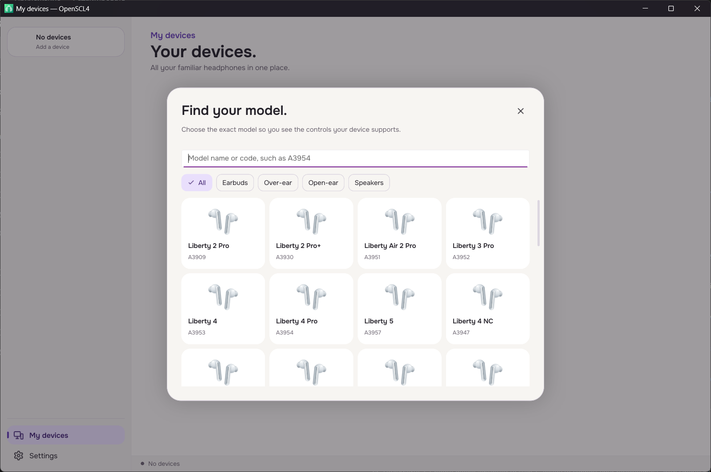

# OpenSCL4 2.0 desktop shell

The desktop app is the **OpenSCL4 2.0 desktop shell**: the product keeps the
OpenSCL4 name, and the UI is **vendored from OpenSCL4** under GPL-3.0; it is not
a new design. The Slint tree in `ui/` comes from
`D:\Projects\OpenSCL4\desktop\ui` at commit `01276e08` and keeps the upstream
layout, components, pages, icons, fonts and art.

## Status

- The shell compiles and opens; the window title still says OpenSCL4.
- The app is built as crate version `2.0.0`, and `AppState.app-version` is
  filled from that crate version, so the About section says
  “OpenSCL4 2.0.0”.
- The vendored **Add Device** dialog is populated from the clean-room catalog
  (`core/crates/models/src/catalog.rs`) through `src/catalog_adapter.rs`: all
  39 supported models as cards with their name, code and device art.
- The existing category chips filter by form factor: **All**, **Earbuds**
  (TWS and sleep buds — the vendored UI has no Sleep chip), **Over-ear**,
  **Open-ear** and **Speakers**. The search field filters by model name or code.
- Choosing a model advances the existing dialog to its paired-device step with
  that model's name, code and art. The step lists the Windows-paired Soundcore
  candidates for that model — devices that advertise the model's Soundcore
  vendor RFCOMM service, or the standard SPP service when the model has none —
  and marks the likely match with “looks like the chosen model”.
- The MVP connects to real paired devices over classic Bluetooth RFCOMM. The
  Windows transport (`src/transport_windows.rs`) opens the model's vendor
  service with the standard SPP fallback; the clean-room session
  (`core/crates/session`) writes the single `01 01` state request and parses the
  answer; **Overview** then shows the connected device's name, code and battery
  tiles (`src/controller.rs`).
- Battery tiles are left/right for the TWS models. Single-battery models show
  one whole-device tile on their own step scale, e.g. a raw `2/10` reads `20 %`.
- Connecting shows “Connecting…”, and Bluetooth off, not found, timeout and
  unsupported-layout failures each show a readable message instead of a crash.
  Cancel and Retry are wired. The vendored UI has no disconnect control; the
  controller's `disconnect` action clears the current device and returns to My
  Devices.
- Only the one state request is written to the device; pairing stays in Windows
  settings and the app never changes it.
- Pages other than Overview and My Devices still open in their placeholder
  state, which is expected: this MVP does not implement settings, equalizer,
  controls, comfort or connections.

## Screenshots


The connected Overview from the running app on Windows: a paired
**soundcore P20i** (A3949) answered the `01 01` state request over RFCOMM, and
its left and right battery tiles read 100 % each (raw 5 of 5 steps). No
Bluetooth address or serial number appears on this page or in the capture.



The Add Device dialog with the catalog populated, captured from the running app
on Windows.

## Run

```powershell
cd desktop
cargo run
```

## License and attribution

GPL-3.0-or-later. The vendored files keep their upstream copyright; see
`ui/SOURCE.md` and the root `NOTICE`. Changes to vendored files are recorded in
the commit that makes them.
