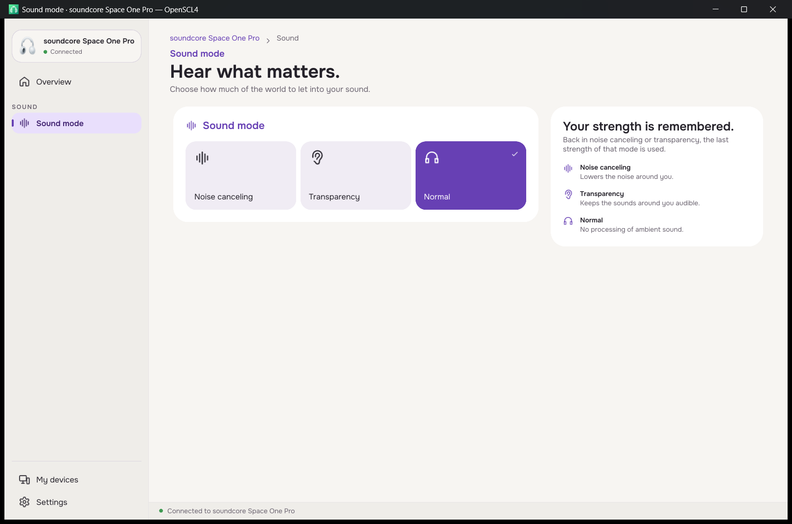

# OpenSCL4 2.0 desktop shell

The desktop app is the **OpenSCL4 2.0 desktop shell**: the product keeps the
OpenSCL4 name, and the UI is **vendored from OpenSCL4** under GPL-3.0; it is not
a new design. The Slint tree in `ui/` comes from
`D:\Projects\OpenSCL4\desktop\ui` at commit `01276e08` and keeps the upstream
layout, components, pages, icons, fonts and art.

## Status

- The shell compiles and opens; the window title still says OpenSCL4.
- The app is built as crate version `2.0.0`, and `AppState.app-version` is
  filled from that crate version, so the About section says
  “OpenSCL4 2.0.0”.
- The vendored **Add Device** dialog is populated from the model catalog
  (`core/crates/models/src/catalog.rs`) through `src/catalog_adapter.rs`: all
  39 supported models as cards with their name, code and device art.
- The existing category chips filter by form factor: **All**, **Earbuds**
  (TWS and sleep buds — the vendored UI has no Sleep chip), **Over-ear**,
  **Open-ear** and **Speakers**. The search field filters by model name or code.
- Choosing a model advances the existing dialog to its paired-device step with
  that model's name, code and art. The step lists the Windows-paired Soundcore
  candidates for that model — devices that advertise the model's Soundcore
  vendor RFCOMM service, or the standard SPP service when the model has none —
  and marks the likely match with “looks like the chosen model”.
- The MVP connects to real paired devices over classic Bluetooth RFCOMM. The
  Windows transport (`src/transport_windows.rs`) opens the model's vendor
  service with the standard SPP fallback; the session
  (`core/crates/session`) writes the `01 01` state request and parses the
  answer, and writes the measured A3062 `06 81` sound-mode and `03 87`
  equalizer frames; **Overview** then shows the connected device's name, code
  and battery tiles (`src/controller.rs`).
- Battery tiles are left/right for the TWS models. Single-battery models show
  one whole-device tile on their own step scale, e.g. a raw `2/10` reads `20 %`.
- The **Sound mode** page is implemented for the models the core measures a mode
  for — today the Space One Pro (A3062). On connect the page shows the device's
  current mode (noise canceling, transparency or normal); choosing a tile writes
  one `06 81` mode frame, then re-reads the `01 01` state (skipping the mode
  acknowledgement) and selects the mode the device reports. A model without a
  measured sound mode, e.g. the P20i (A3949), gets no Sound mode page and no
  mode frame.
- The **Equalizer** page is implemented for the models the core reports an
  equalizer for — today the Space One Pro (A3062). On connect the page shows the
  device's current preset and its curve: the 22 catalog presets as chips (the
  current one checked) and the eight visible band values in the measured
  −12.0…+13.4 dB range on the vendored chart. Choosing another chip writes one
  `03 87` preset frame, then re-reads the `01 01` state and selects the preset,
  its name and its curve from what the device reports.
- The eight A3062 bands are **editable**, so the page is not read-only: each
  band has a value field and a slider, and there is a Reset button. Dragging a
  chart point or a slider previews the curve locally and writes nothing; letting
  go, or pressing Enter in a field, writes one `03 87` custom frame (`0xFEFE`
  and the eight visible values, the rest of the measured body copied from the
  last re-poll) and then re-reads the `01 01` state, so the chart, the name tag
  (“Your own settings”) and the fields follow the device. Reset writes a flat
  custom curve. Built-in preset chips still work and switch the device away
  from a custom curve and back. Saved profiles, import/export and HearID stay
  out of scope and their vendored controls stay hidden.
- The P20i (A3949) equalizer is deliberately deferred in this slice: the
  committed A3949 state carries an equalizer block at body 32..44, but no A3949
  `03 87` write body is verified, so the page stays hidden and no equalizer
  frame is sent for that model.
- Connecting shows “Connecting…”, and Bluetooth off, not found, timeout and
  unsupported-layout failures each show a readable message instead of a crash.
  Cancel and Retry are wired. The vendored UI has no disconnect control; the
  controller's `disconnect` action clears the current device and returns to My
  Devices.
- Only the `01 01` state request, the `06 81` sound-mode frame and the `03 87`
  equalizer frames (the built-in preset and the custom bands) are written to the
  device; pairing stays in Windows settings and the app never changes it.
- ANC strength, wind noise, adaptive ANC and the 1-to-11 strength scale are not
  part of this slice, so the Sound mode page shows only the three mode tiles.
  Saved equalizer profiles, import/export, the profile list and HearID are out
  of scope as well: those vendored controls keep their empty state and no
  profile is saved, listed or read.
- Pages other than Overview, My Devices, Sound mode and (for an A3062) the
  Equalizer still open in their placeholder state, which is expected: this shell
  does not implement controls, comfort or connections.

## Screenshots


The connected Overview from the running app on Windows: a paired
**soundcore P20i** (A3949) answered the `01 01` state request over RFCOMM, and
its left and right battery tiles read 100 % each (raw 5 of 5 steps). No
Bluetooth address or serial number appears on this page or in the capture.



The Sound mode page from the running app on Windows: a paired **soundcore
Space One Pro** (A3062) is connected over RFCOMM and its current mode (normal)
is selected; noise canceling, transparency and normal are the three choices.
Choosing another mode writes one `06 81` frame and re-reads the `01 01` state.
No Bluetooth address or serial number appears on this page or in the capture.


The Equalizer page from the running app on Windows: a paired **soundcore
Space One Pro** (A3062) is connected over RFCOMM and its bands are editable.
The eight band fields and sliders, the chart, the Reset button and all 22
catalog preset chips are shown. A typed custom curve (+4.0 dB at 100 Hz,
−4.0 dB at 800 Hz) was committed and re-read from the device, so the name tag
reads “Your own settings” and the fields hold the re-polled values. Typing a
value or letting go of a drag writes one `03 87` custom frame (`0xFEFE`), then
re-reads the `01 01` state; Reset writes a flat custom curve. Saved profiles,
import/export and HearID are out of scope and hidden. No Bluetooth address or
serial number appears on this page or in the capture.


The Add Device dialog with the catalog populated, captured from the running app
on Windows.

## Run

```powershell
cd desktop
cargo run
```

## License and attribution

GPL-3.0-or-later. The vendored files keep their upstream copyright; see
`ui/SOURCE.md` and the root `NOTICE`. The protocol command/response and
equalizer-preset data adapted from OpenSCL4 is attributed in the root `NOTICE`
too. Changes to vendored files are recorded in the commit that makes them.
