# OpenSCL4 2.0 desktop shell

The desktop app is the **OpenSCL4 2.0 desktop shell**: the product keeps the
OpenSCL4 name, and its Slint UI is based on **OpenSCL4** under GPL-3.0. The tree
in `ui/` comes from `D:\Projects\OpenSCL4\desktop\ui` at commit `01276e08` and
keeps the upstream palette, typography, icons, fonts and art. Local adaptations
include the Connections row actions, the Diagnostics workflow, the restored
configurable Overview and the internal UI kit documented in `ui/UI_KIT.md`;
vendored-file changes are recorded in `ui/SOURCE.md`.

## Status

- The Windows shell runs against the committed UI kit. With no Bluetooth
  hardware at all, the app can still be exercised end to end through the
  built-in **Demo mode** (see below): every page, Settings choice, Overview
  preference and notification-area switch is reachable and persists, while all
  device data stays simulated.
- The app is built as crate version `2.0.0`, and `AppState.app-version` is
  filled from that crate version, so the About section says
  “OpenSCL4 2.0.0”.
- The vendored **Add Device** dialog is populated from the model catalog
  (`core/crates/models/src/catalog.rs`) through `src/catalog_adapter.rs`: all
  39 supported models as cards with their name, code and device art.
- The existing category chips filter by form factor: **All**, **Earbuds**
  (TWS and sleep buds — the vendored UI has no Sleep chip), **Over-ear**,
  **Open-ear** and **Speakers**. The search field filters by model name or code.
- Choosing a model advances the existing dialog to its paired-device step with
  that model's name, code and art. The step lists the Windows-paired Soundcore
  candidates for that model — devices that advertise the model's Soundcore
  vendor RFCOMM service, or the standard SPP service when the model has none —
  and marks the likely match with “looks like the chosen model”.
- The MVP connects to real paired devices over classic Bluetooth RFCOMM. The
  Windows transport (`src/transport_windows.rs`) opens the model's vendor
  service with the standard SPP fallback; the session
  (`core/crates/session`) writes the `01 01` state request and parses the
  answer, and writes the measured A3062 `06 81` sound-mode, `03 87` equalizer
  and remaining-settings frames. **Overview** then shows the connected device's
  identity, battery tiles and the blocks supported by its actual state: Sound
  mode and Equalizer panels plus Controls, Comfort, Sound and effects, Power,
  and Connections shortcuts (`src/overview.rs`, `src/controller.rs`). The user
  can reorder or hide supported blocks, choose Minimal/Standard/Full layouts and
  select per-model quick toggles; the A3062 defaults to LDAC. Choosing which
  toggles to display changes only UI preferences, while clicking a displayed
  chip uses the normal device write-and-re-poll path. Quick presets and case are
  not shown until the core supplies real data for them.
- Overview layout and per-model quick-toggle selection persist in
  `%APPDATA%\OpenSCL4\overview-preferences.json`, written atomically through a
  temporary file and a rename. Its comma-separated block IDs and `!` visibility
  markers retain the previous desktop/Android layout format; unknown and
  duplicate IDs are ignored, and device state is never stored in the document.
- Battery tiles are left/right for the TWS models. Single-battery models show
  one whole-device tile on their own step scale, e.g. a raw `2/10` reads `20 %`.
- The **Sound mode** page is implemented for the models the core measures a mode
  for — today the Space One Pro (A3062). On connect the page shows the device's
  current mode (noise canceling, transparency or normal); choosing a tile writes
  one `06 81` mode frame, then re-reads the `01 01` state (skipping the mode
  acknowledgement) and selects the mode the device reports. A model without a
  measured sound mode, e.g. the P20i (A3949), gets no Sound mode page and no
  mode frame.
- The **Equalizer** page is implemented for the models the core reports an
  equalizer for — today the Space One Pro (A3062). On connect the page shows the
  device's current preset and its curve: the 22 catalog presets as chips (the
  current one checked) and the eight visible band values in the measured
  −12.0…+13.4 dB range on the vendored chart. Choosing another chip writes one
  `03 87` preset frame, then re-reads the `01 01` state and selects the preset,
  its name and its curve from what the device reports.
- The eight A3062 bands are **editable**, so the page is not read-only: each
  band has a value field and a slider, and there is a Reset button. Dragging a
  chart point or a slider previews the curve locally and writes nothing; letting
  go, or pressing Enter in a field, writes one `03 87` custom frame (`0xFEFE`
  and the eight visible values, the rest of the measured body copied from the
  last re-poll) and then re-reads the `01 01` state, so the chart, the name tag
  (“Your own settings”) and the fields follow the device. Reset writes a flat
  custom curve. Built-in preset chips still work and switch the device away
  from a custom curve and back.
- **Saved equalizer profiles** are implemented for the editable A3062 page: the
  vendored **My profiles** panel and its **Save profile** dialog, row list and
  delete confirmation are wired. Saving stores the eight current bands under a
  name; a saved row shows the profile's curve thumbnail, “Bands: 8” and an
  **Applied** tag while the device's bands are exactly the profile's. Clicking a
  row applies it as one custom `03 87` frame (`0xFEFE` and the profile's eight
  bands) followed by a `01 01` re-poll, so the chart, fields and Applied tag
  follow the device. The row menu's **Delete** removes the profile after the
  confirmation dialog. Profiles persist across restarts in
  `%APPDATA%\OpenSCL4\equalizer-profiles.json` (schema v1, written atomically
  through a temporary file and a rename); the file is loaded at startup, and a
  missing, unreadable or invalid document starts empty and is logged to stderr
  instead of crashing. A duplicate name asks before replacing, an empty or
  whitespace-only name is rejected with a dialog message, and out-of-range bands
  are clamped by the page's edits to the measured range and rejected by the core
  model and on document load before they can be stored. A save or delete whose
  document cannot be written is not silent: the failed change is rolled back (the
  list and the file stay as they were), the page error banner says
  “Could not save equalizer profiles” and the reason is also logged to stderr.
- **Profile import** is implemented in that panel: **Paste** reads the Windows
  clipboard and **Open file** opens a native JSON picker (files over 1 MiB are
  refused). A parseable OpenSCL4 transfer-profile document opens the vendored
  **Import profiles** dialog with one row per profile — **New**, **Replaces**
  (a saved profile has the same name), and the blocking **wrong band count** and
  **out of range** statuses — plus a red note and a disabled **Import** button
  when anything is blocked. Confirming re-validates the whole file all-or-nothing
  and merges it into the saved profiles (same-named profiles are replaced),
  writes the document and closes the dialog with the **Imported** note and toast;
  blocked files write nothing and leave the dialog open. A parse failure shows
  “This is not an equalizer profiles file” and an empty clipboard “The clipboard
  is empty”. Legacy migration stays out of scope: the legacy migration banner
  stays hidden because `eq-legacy` is always empty. HearID is out of scope too.
- **Profile export** is implemented in the same panel. The Export block lists
  the saved profiles with a checkbox each plus **Select all**, and the number of
  chosen profiles (the same count that checks **Select all**) enables **Save to
  file** and **Copy**; the profile row menu's **Save to file** item chooses that
  profile alone. **Save to file** opens the native Windows save dialog with the
  default name `openscl4-equalizer-profiles.json` and writes the chosen profiles
  as OpenSCL4 transfer JSON — one compact array of `name` plus the eight
  `volumeAdjustments` dB values with one decimal, e.g.
  `[{"name":"Warm","volumeAdjustments":[3.0,-3.0,6.0,0.0,-6.0,2.0,0.0,-2.0]}]`.
  A written file shows the **Saved to the file** note and toast; cancelling the
  dialog changes nothing (no note, no toast, no file) and a failed write shows
  “Could not save the file”. **Copy** puts exactly the same JSON on the Windows
  clipboard and shows the **Copied** toast. The exported file or pasted text
  re-imports through the import path above, so it previews as **New** (or
  **Replaces** for names already saved) with the same bands. The deferred A3949
  has no saved-profile panel and therefore no export either.
- The **Controls**, **Comfort**, **Power and prompts**, **Sound and effects**,
  **Connections** and **About the device** pages are implemented for the
  A3062: they are filled from the settings block of the `01 01` state (body
  67..87), so the buttons, comfort and power settings, LDAC/Dolby toggles and
  About values (charging, battery, firmware; the serial is deliberately not a
  row) are the device's own. **Connections** also offers the Windows links
  **Bluetooth and devices** and **Sound**, which open the corresponding
  `ms-settings:` page in the system Settings app. Every change writes exactly
  one measured settings frame and then re-reads `01 01`, so the row, the page
  and About follow the device's answer; a control dragged or selected more than
  once only keeps the newest write. A failed write shows the readable page
  banner (“Could not change …”, with **Retry** to reconnect) instead of leaving
  a stale value. The banner means the write or its confirmation poll failed, not
  that the device kept the old value: the vendored second sentence is fixed
  wording, so the device's state is unknown until **Retry** re-polls it.
- **Dual connections** is implemented for the A3062: after connecting, while the
  device reports dual connections on, the app reads the earbuds' remembered-device
  list with a bounded multi-frame `0B 01` read and shows it on **Connections** as
  the vendored list panel — one row per remembered device with the parsed name and
  a “— connected” marker taken from the device's own connected flag (the address
  bytes are never shown, logged or put in an option string). Each row offers
  **Connect**, **Disconnect** and **Forget**; a click writes exactly one measured
  `0B 82` / `0B 81` / `0B 83` frame and then re-reads `0B 01` (the connect and
  disconnect writes retry the read for a few seconds because the earbuds take a
  moment to settle), so the list and its markers follow the device's own answer.
  With dual connections off the list is hidden and no `0B 01` is sent; turning it
  on writes `0B 84` on, re-polls `01 01`, and only then reads the list. Options and
  row actions are built from the same last reply, so an index can never name a
  different device. **Forget** is the device's own `0B 83`: it removes the row from
  the earbuds' remembered list for good (it un-pairs that device from the earbuds),
  which is why the vendored note warns that forgetting this computer ends control
  of the earbuds. The list is A3062-only; the P20i (A3949) never reads or writes a
  `0B` frame and keeps the Connections page without the list.
- **Demo mode** is available in the Add Device dialog's paired-device step: switching
  it on replaces the Windows paired-device list with one simulated Space One Pro
  (A3062, a neutral all-zero placeholder address, name “soundcore Space One Pro · Demo”).
  Connecting to it needs no pairing, no Bluetooth/RFCOMM link, no device session
  and no Windows device lookup: the state is parsed from the committed sanitized
  A3062 capture (`core/data/a3062-state.json`), and an in-process demo worker
  serves the same event and command channel a real device worker uses, handling
  every command against that local state, so the UI wiring is the same and no
  command leaves the process. Sound mode, equalizer presets, custom bands, the
  settings rows and the dual-connections list update only the simulated state;
  the app never writes a frame to a device, never looks up a Windows device for
  it and never produces diagnostics from it. The Diagnostics page is marked
  unavailable with a demo-mode explanation because there is no radio to probe. My Devices keeps the saved demo card —
  marked “Demo device · Not connected” while disconnected — and Disconnect /
  Connect work without hardware; each connect starts from the captured state
  again, so demo writes do not persist (demo-only behaviour). Demo mode is offered
  for the Space One Pro only, the one model with a committed demo capture;
  choosing another model keeps the real paired-device list and says demo data is
  not available.
- The **notification-area tray** uses the vendored `ui/tray.slint` component and
  Slint's Windows `SystemTrayIcon`: the OpenSCL4 icon with a tooltip naming the
  device and, while connected, its battery (“OpenSCL4 · soundcore Space One Pro”
  over “Battery 40%”), and a menu with the device and its connection status, the
  battery line, the **Sound mode** submenu (the current mode checked; choosing one
  writes the same `06 81` frame as the page and re-reads `01 01`), the **LDAC**
  item (the same settings write as the Sound and effects row), **Connect** while a
  saved device is not connected (the same retry as the page's banner),
  **Open OpenSCL4** and **Quit**. Closing the window hides it to the notification
  area while the icon is hosted and close-to-tray is on; the icon's Open item (or
  a left click) shows it again; **Quit** ends the program and removes the icon. A
  second start of the executable finds the running instance, asks it to show the
  window and exits, so there is only ever one window and one icon. The Settings
  page's **Desktop and quick access** panel hosts the switches (the icon, the four
  menu sections, close-to-tray) and a **Quit** button. Choices persist in
  `%APPDATA%\OpenSCL4\desktop-preferences.json`, separately from Overview and
  profiles. They load before the icon is created; missing fields use defaults,
  missing/malformed files start safely, and saves use a flushed temporary file
  and rename.
- The **Settings** page owns the app's own appearance, language and quick access.
  **Theme** is Follow system, Light or Dark: Follow system resolves Windows' app
  mode once the native window exists, keeps re-reading it while it is chosen and
  follows a system light/dark switch without a restart. **Palette** chooses the
  Purple, Sage or Rose accent, **Content scale** sets 100 %, 110 %, 125 % or
  150 % (theme tokens already include it) and **Device color in pictures** draws
  the current device, every saved card, the Add Device model list and the chosen
  model as the theme's color, Silver or Black. **App language** offers Follow
  system plus the 16 bundled languages by their own names; the choice is applied
  to the running window immediately and a code Slint does not bundle falls back
  to English instead of failing. **Copy logs** puts the recent application log
  lines on the Windows clipboard (a clipboard failure is logged, not fatal).
  Controls the connected device cannot use are not offered: the one-earbud badge
  needs a TWS pair (the single-battery A3062 never shows it) and the sound-mode
  view choice needs a device whose core reports the 1–11 scale (the A3062 has
  only its three modes and no core model exposes that scale yet, so the choice
  stays hidden). Every choice applies to the running window at once and
  is saved through the same flushed temporary file and rename into
  `%APPDATA%\OpenSCL4\desktop-preferences.json`, the one document that also
  holds the notification-area choices. On the next start the saved theme,
  palette, content scale, art color, language, badge and tray choices come back;
  a missing or malformed document starts from the defaults. The bundled
  translation documents predate the Diagnostics panel and the Demo-mode copy, so
  those few newer strings are shown in English in every language; the language
  choice itself is applied to the whole window.
- The P20i (A3949) equalizer is deliberately deferred in this slice: the
  committed A3949 state carries an equalizer block at body 32..44, but no A3949
  `03 87` write body is verified, so the page stays hidden and no equalizer
  frame is sent for that model — the P20i therefore also has no saved-profile
  panel, no profile writes and no import or export controls, and no section
  pages or settings writes: it keeps only Overview and My devices as before.
- Connecting shows “Connecting…”, and Bluetooth off, not found, timeout and
  unsupported-layout failures each show a readable message instead of a crash.
  Cancel and Retry are wired. The connected card in **My devices** has a visible
  **Disconnect** action: it drops only the app's link, keeps the saved card and
  returns to My Devices. This is distinct from the dual-connections list, whose
  Disconnect operates on a device remembered by the earbuds.
- The only device writes are the read-only `01 01` state request, the `06 81`
  sound-mode frame, the `03 87` equalizer frames (a built-in preset, the custom
  bands, and an applied saved profile's custom curve), the measured one-frame
  settings writes behind the section pages, and the dual-connections writes
  (`0B 84` for the setting, `0B 82`/`0B 81`/`0B 83` for a list row); its `0B 01`
  list request is the only other read. In Demo mode these same requests and
  commands are answered in-process by the demo worker against its simulated
  state, so no frame is written to a device. The app's persisted files are the
  saved profiles, Overview preferences and desktop/tray preferences. Windows
  pairing stays in Windows settings and the app never changes it; **Forget**
  asks the earbuds themselves to drop a remembered device, which is the
  un-pairing the vendored note warns about.
- ANC strength, wind noise, adaptive ANC and the 1-to-11 strength scale are not
  part of this slice, so the Sound mode page shows only the three mode tiles. The
  Settings **Sound modes** view choice is therefore deferred until a core model
  exposes that 1–11 scale: it is still saved but stays hidden
  (`app-mode-view-applies` is always false) rather than offering a fake view.
  Legacy migration and HearID are out of scope: their vendored controls keep
  their empty or hidden state, as described above.
- Tray **Quick presets** stay out of scope: the app has no quick presets, so the
  vendored panel's preset switch is saved with the other choices but the menu
  never shows a preset section (and never says “No presets yet”). The tray does
  not change the sound mode beyond the three modes the Sound mode page has. A
  new installation starts with icon and close-to-tray on, battery/modes/LDAC
  sections on and presets off; later runs load the saved choices. This slice has
  no tray on Linux or macOS.
- Writing the dual-connections setting or LDAC makes the real A3062 reset its
  Bluetooth links: the write can be acknowledged and the following re-poll or
  list read then hits a closed link, so the page shows the readable “connection
  lost” banner (and `0B 01` list read/`LDAC (connection lost)` names) and
  **Retry** opens a fresh connection. The same happens when the list's
  **Disconnect** is used on this computer's own row: the earbuds drop the PC link
  the app talks over, the banner says the list could not be re-read, and
  **Retry** reconnects. That is device behaviour, not a crash: every reconnect
  then read or wrote normally again. One user-requested connection makes at most
  four attempts with short pauses when Windows is still closing the previous
  RFCOMM link; this is not an automatic reconnect after an idle-link failure.
- For models with a persistent device worker, 15 seconds of command idle time
  triggers a read-only `01 01` heartbeat on that same worker. A successful answer
  changes no setting and emits no synthetic UI update. A failed heartbeat clears
  the worker, shows **Connection lost** with **Connect again**, and leaves the
  saved card available; there is deliberately no automatic reconnect. Commands
  already queued run before the first heartbeat, and Disconnect drops the command
  channel so no further heartbeat is scheduled.
- The **Diagnostics** page runs the three read-only probes (`01 01`, `01 03`,
  `01 04`) on the connected device worker, shows each probe's answer as it
  arrives, builds a local ZIP with `manifest.json`, `frames.jsonl` and
  `README.txt`, saves it through the native dialog and opens a prefilled GitHub
  issue. The A3062 serial and Bluetooth addresses are redacted by the core
  before the archive is written, including the state serial inside the
  manifest's probe responses (not only in `frames.jsonl`); nothing is uploaded
  by the app. The page also
  opens without a device and shows an empty state. Its device summary, panels,
  progress, probe states and metric tiles use the internal UI kit; wide layouts
  place supporting information in an aside, while narrow layouts stack content
  and actions in one scrollable column.
- Pages other than Overview, My Devices, Settings, Diagnostics, Sound mode,
  Equalizer, Sound and effects and the five A3062 device pages still open in
  their placeholder state, which is expected: the A3062 has no case, sleep,
  lights or alarms page and this shell does not implement them.
- The finished client is **accepted on the real Space One Pro (A3062, firmware
  04.39)** on Windows: the app connects through Add Device over real RFCOMM (no
  Demo mode) and the run covered the Overview, every implemented sound and
  device page, sound mode and equalizer preset/custom writes with their
  `01 01` re-polls and restores, equalizer profile save/apply plus the import
  and export roundtrip, one settings write per section page with re-poll and
  restore, the Settings appearance/language/tray choices and their restart
  persistence, **Copy logs**, the notification-area icon with its real battery
  tooltip, close-to-tray and Quit, the three Diagnostics probes with a real
  **Save ZIP** whose archive carries no serial or Bluetooth address and the
  prefilled GitHub issue, and the idle heartbeat with the Lost/Retry path. The
  device settings found on connect were restored and the app's preference
  documents were put back. The acceptance also found and fixed a redaction
  defect: a probe's `responseHex` in `manifest.json` still carried the A3062
  serial; the diagnostics session now masks a state probe response before it is
  stored/exported.

## Screenshots

The real-device captures in this section were taken during the earlier RFCOMM
acceptance slices. The three Demo-mode captures come from the demo-acceptance
build (ticket 04) run on Windows with no Bluetooth hardware: their device values
are simulated and the Settings capture predates the 150 % content-scale choice,
so they document the interface only and are not a hardware-acceptance result. No
Bluetooth address or serial number appears in any of them.

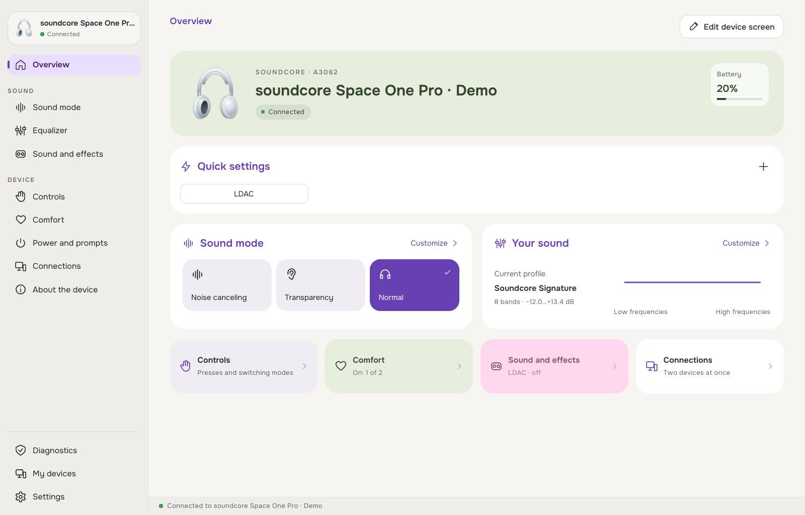

The Overview of the **simulated** Space One Pro (A3062) in Demo mode, captured
from the running app on Windows. The hero names the simulated device
(“soundcore Space One Pro · Demo”) and shows the capture's battery (20 %), the
Quick settings panel holds the saved LDAC chip, the Sound mode and Your sound
panels follow the simulated state, and the four shortcut cards are the saved
Standard layout. Every value is parsed from the sanitized committed A3062
capture; no Bluetooth/RFCOMM link or device session is opened, and no command
leaves the process — the in-process demo worker only serves the simulated state,
so no frame is written to a device.

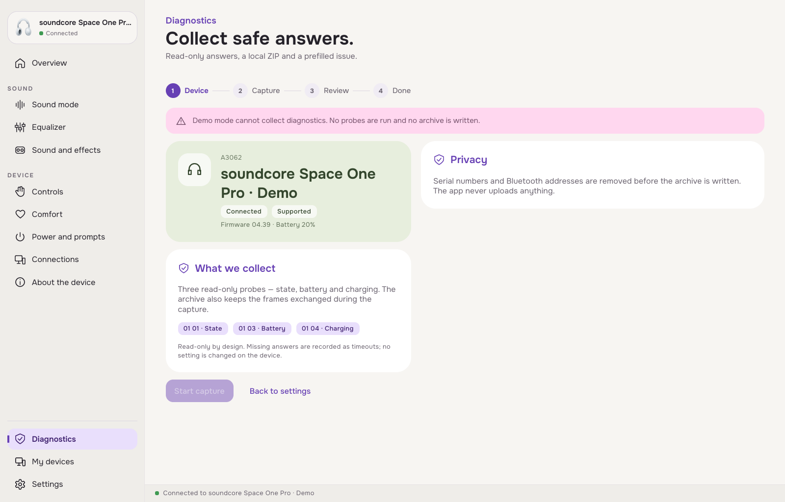

The Diagnostics page after a Demo-mode connect. The banner says “Demo mode cannot
collect diagnostics. No probes are run and no archive is written.”, **Start
capture** is disabled, and no **Save ZIP** or **Open GitHub issue** action is
offered, because a simulated device has no radio to probe. The page still shows
the device summary it last read (A3062, firmware 04.39, battery 20 %); nothing
was captured or written.

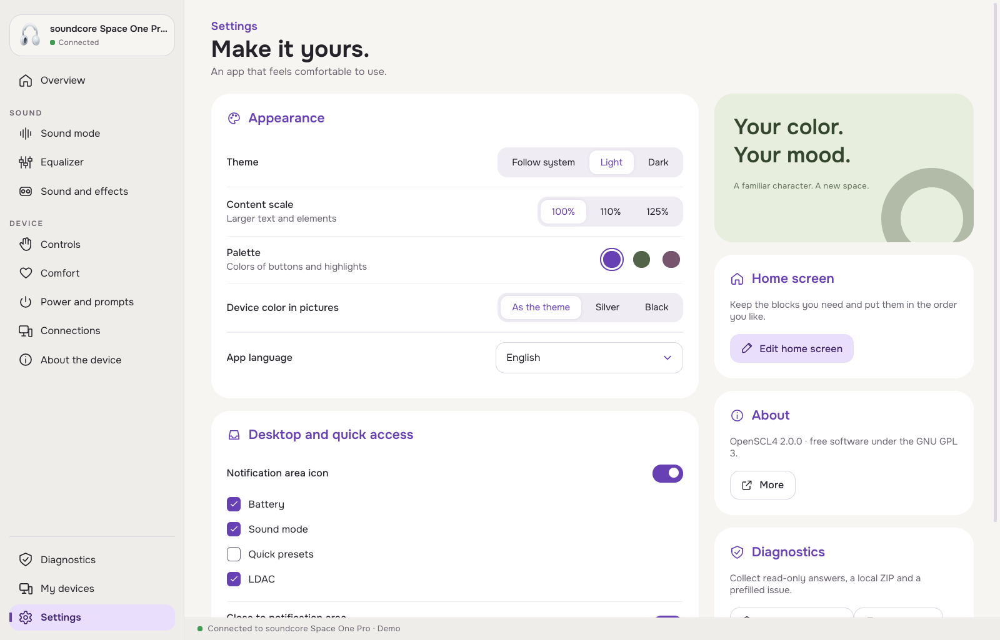

The **Settings** page from the running demo app. Every appearance choice has been
applied and saved: Light theme (Follow system/Light/Dark works the same way),
Purple palette, 100 % content scale, As the theme device color, English language,
the notification-area icon and its sections, and Quick presets off. The
one-earbud badge switch and the sound-mode view choice are absent because the
connected A3062 is a single-battery, three-mode device. These choices live in
`%APPDATA%\OpenSCL4\desktop-preferences.json` and come back after a restart.

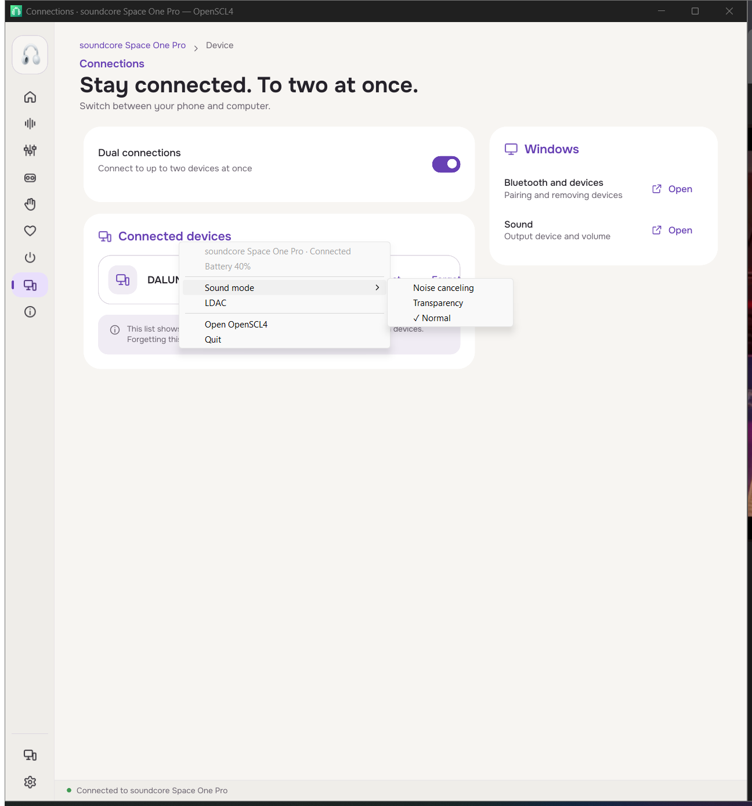

The notification-area menu from the running app on Windows: a paired
**soundcore Space One Pro** (A3062) is connected over RFCOMM, so the icon's
tooltip reads “OpenSCL4 · soundcore Space One Pro” over “Battery 40%” and the
menu shows the device with **Connected**, the battery line, the **Sound mode**
submenu with the current mode checked (“✓ Normal”), the **LDAC** item, **Open
OpenSCL4** and **Quit**. This capture was taken with the Sound mode submenu open;
the menu was opened from the notification-area icon through its Win32 callback
message, and every action was exercised on the bench: a mode chosen from the
submenu was written and re-read (the check moved from Normal to Transparency and
back), LDAC was toggled on and off again, Open restored the window after a close,
and Quit ended the process and removed the icon. No Bluetooth address or serial
number appears in the capture; the names are the devices' own names.

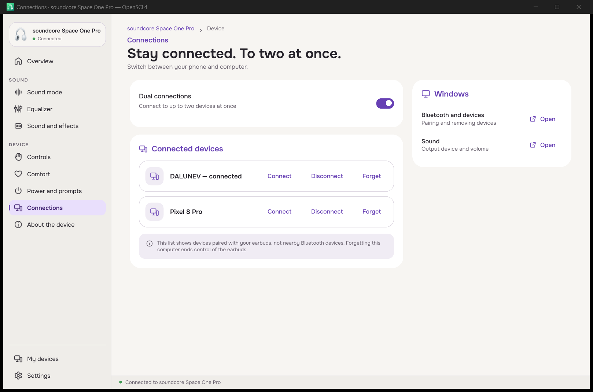

The **Connections** page from the running app on Windows: a paired **soundcore
Space One Pro** (A3062) is connected over RFCOMM with dual connections on, and the
vendored **Connected devices** list shows the devices the earbuds remember —
**DALUNEV — connected** (this computer) and **Pixel 8 Pro** — each with
**Connect**, **Disconnect** and **Forget**. The list is read with a bounded
multi-frame `0B 01` read; the row actions write one measured `0B 82` / `0B 81` /
`0B 83` frame and re-read it. On the bench **Forget** removed **Pixel 8 Pro** from
the earbuds' remembered list (a re-read then showed only this computer) and the
row was gone; **Connect** on the disconnected phone row wrote `0B 82` and re-read
the list, but the phone did not report connected (it did not answer the earbuds'
page during the run). No Bluetooth address or serial number appears in the
capture.


The connected Overview from the running app on Windows: a paired
**soundcore P20i** (A3949) answered the `01 01` state request over RFCOMM, and
its left and right battery tiles read 100 % each (raw 5 of 5 steps). No
Bluetooth address or serial number appears on this page or in the capture.


The Sound mode page from the running app on Windows: a paired **soundcore
Space One Pro** (A3062) is connected over RFCOMM and its current mode (normal)
is selected; noise canceling, transparency and normal are the three choices.
Choosing another mode writes one `06 81` frame and re-reads the `01 01` state.
No Bluetooth address or serial number appears on this page or in the capture.


The Equalizer page from the running app on Windows: a paired **soundcore
Space One Pro** (A3062) is connected over RFCOMM and its bands are editable.
The eight band fields and sliders, the chart, the Reset button and all 22
catalog preset chips are shown. A typed custom curve (+4.0 dB at 100 Hz,
−4.0 dB at 800 Hz) was committed and re-read from the device, so the name tag
reads “Your own settings” and the fields hold the re-polled values. Typing a
value or letting go of a drag writes one `03 87` custom frame (`0xFEFE`), then
re-reads the `01 01` state; Reset writes a flat custom curve. That capture was
taken before the saved-profile panel was wired; the current page also shows the
My profiles panel, its Save profile button and the Import and export panel (see
the saved-profiles, import and export captures). Legacy migration and HearID stay
out of scope. No Bluetooth address or serial number appears on this page or in
the capture.

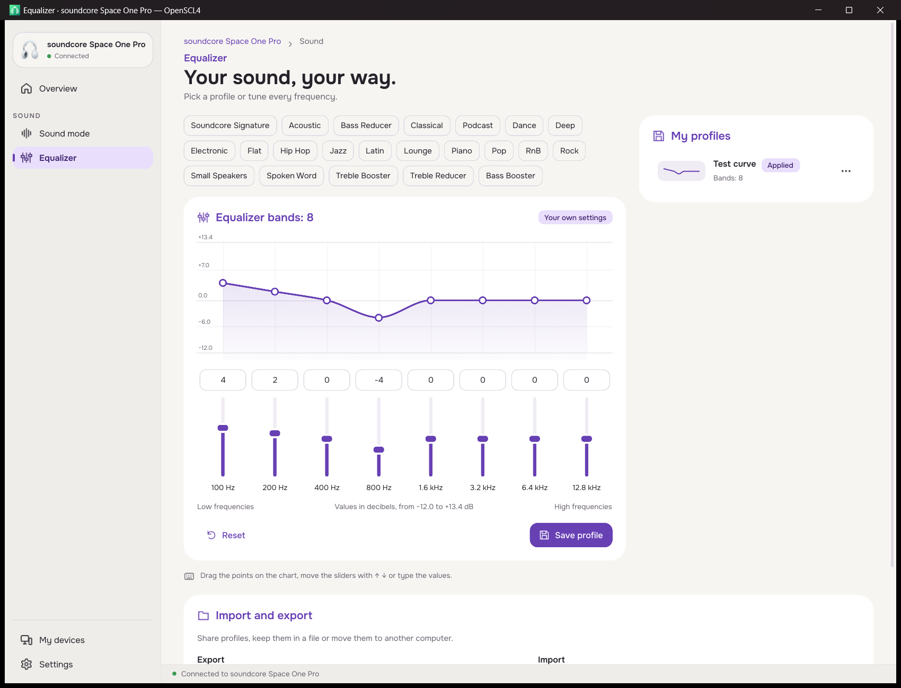

The Equalizer page after restarting the app on Windows: a paired **soundcore
Space One Pro** (A3062) reconnected over RFCOMM, and the saved profile
**Test curve** was loaded from `%APPDATA%\OpenSCL4\equalizer-profiles.json` and
listed in the **My profiles** panel with its curve thumbnail, “Bands: 8” and the
**Applied** tag (the device reported the same eight bands, so the profile is in
effect). This window was driven through the Windows accessibility tree: the
+4.0 / +2.0 / −4.0 dB curve was saved as “Test curve”, the row was clicked to
apply it as one `03 87` custom frame and a `01 01` re-poll, the app was closed
and restarted, and the profile came back from the file. Deleting it afterwards
through the row menu and the confirmation dialog removed the row and left `[]`
in the document. The vendored **Import and export** panel at the bottom is
visible; import and export are implemented now (see the import and export
captures). No Bluetooth address or serial
number appears on this page or in the capture.

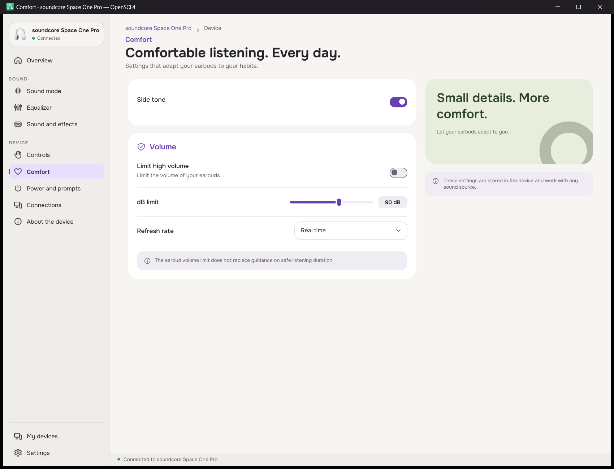

The **Comfort** page from the running app on Windows: a paired **soundcore
Space One Pro** (A3062) is connected over RFCOMM and the page is filled from the
device's own settings block — **Side tone** on, the **Volume** panel with
**Limit high volume** off, **dB limit** 90 dB and **Refresh rate** Real time.
The same connection fills **Controls** (single/double press and the three modes
of the ambient cycle), **Power and prompts** (auto power off 60 minutes, low
battery and voice prompts), **Connections** (dual connections and the Windows
links) and **About the device** (charging, battery 40 %, firmware 04.39; the
serial is not shown). Toggling a row writes exactly one measured settings frame
and re-reads the `01 01` state, so values shown here are the device's answer.
The screenshot was taken after the acceptance run restored every changed value;
no Bluetooth address or serial number appears on the page or in the capture.

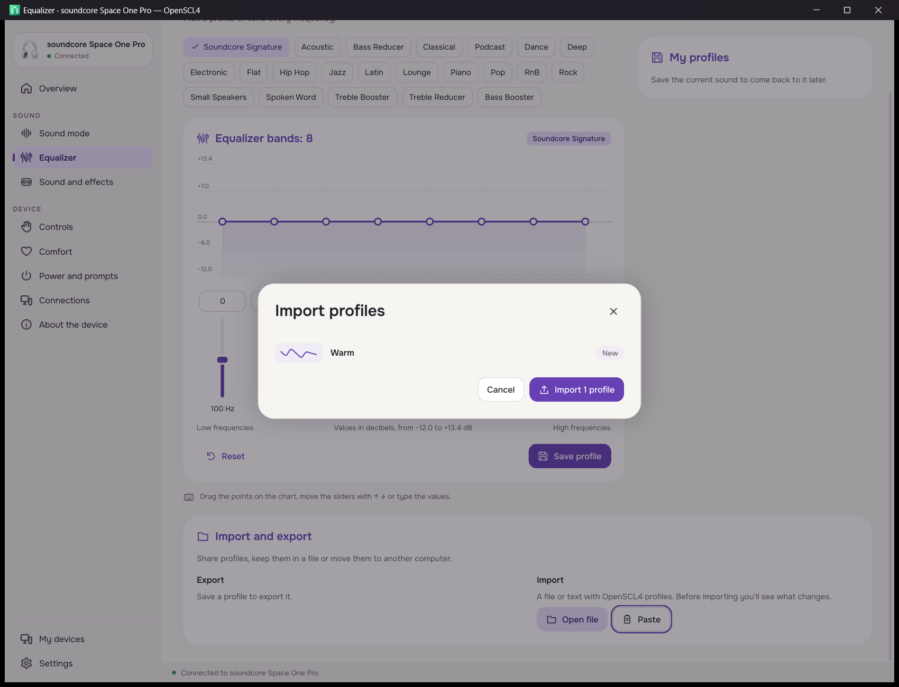

The vendored **Import profiles** dialog after **Paste** read an OpenSCL4
transfer-profile document from the Windows clipboard: one **Warm** profile with
its curve thumbnail and the **New** tag, **Cancel** and **Import 1 profile**.
Confirming writes the profile into the saved set and the
`%APPDATA%\OpenSCL4\equalizer-profiles.json` document and closes the dialog;
clicking the new **My profiles** row then applies it as one custom `03 87` frame
and a `01 01` re-poll (the chart and the **Applied** tag follow the device). A
file the device cannot take — a 7-band profile or a value outside the measured
range — previews in red with **Import** unavailable, and confirming writes
nothing. The legacy migration banner stays hidden (the legacy list is always
empty). No Bluetooth address or serial number appears in the capture.

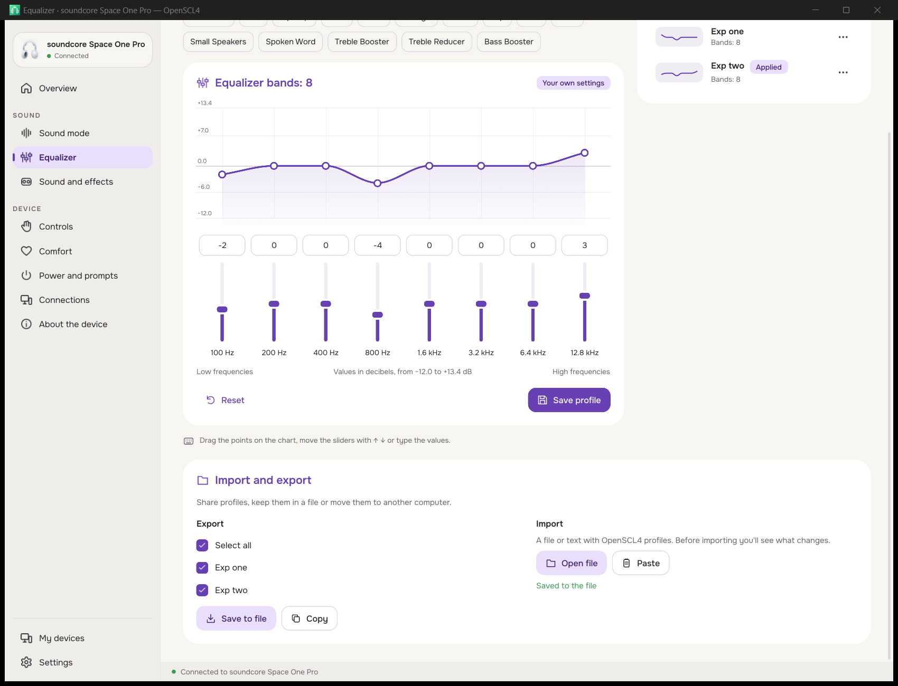

The Equalizer page from the running app on Windows with two saved profiles,
**Exp one** and **Exp two**, chosen for export in the vendored **Import and
export** panel: **Select all** and both row checkboxes are checked and **Save to
file** and **Copy** are enabled (`eq-export-count` is 2). The green **Saved to
the file** note is the panel's answer to a real native save-dialog export of
both profiles (150 bytes of OpenSCL4 transfer JSON); **Copy** put exactly the
same JSON on the Windows clipboard. The exported file then re-imported through
the shipped import path — **Replaces the saved profile** while the two profiles
were still saved, **New** after they were deleted — and the profiles applied to
the device as one custom `03 87` frame and a `01 01` re-poll. No Bluetooth
address or serial number appears in the capture.


The Add Device dialog with the catalog populated, captured from the running app
on Windows.

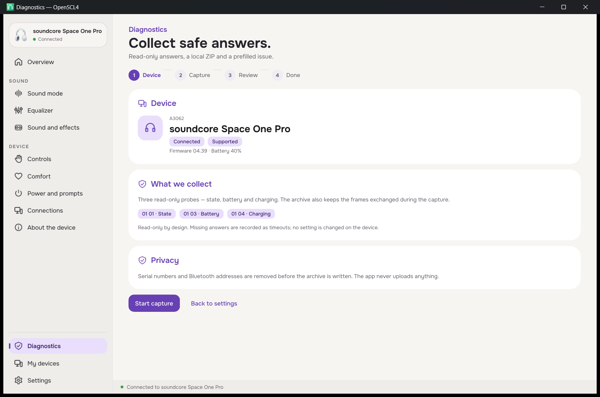

The **Diagnostics** page from the running app on Windows with a paired
**soundcore Space One Pro** (A3062) connected: the page shows the device, the
three read-only probes it will run (`01 01`, `01 03`, `01 04`), the redaction
notice and **Start capture**. The buttons and cards are laid out by the same
vendored shell as the other pages.

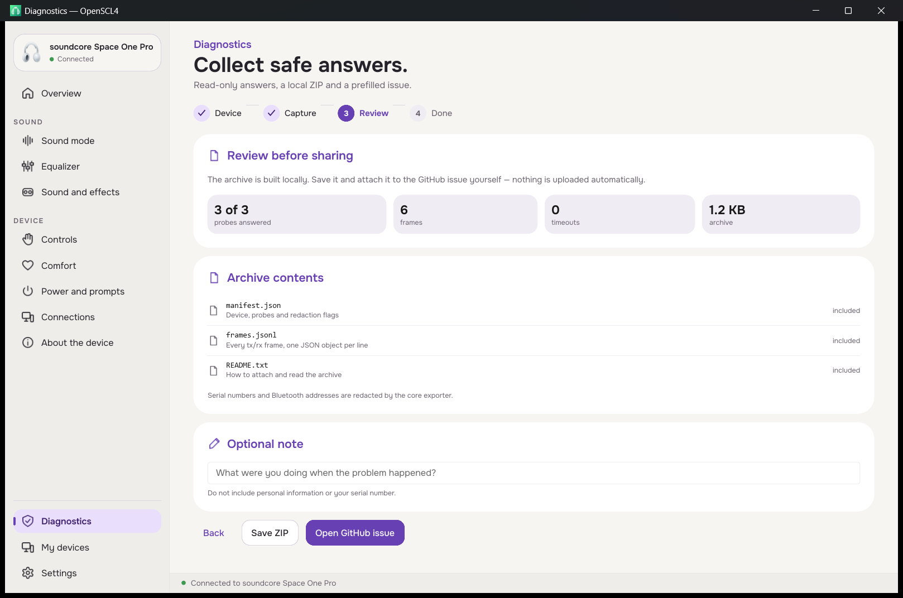

The **Review** step after a real capture: all three probes answered, six frames
were recorded, the archive is 1.2 KB and its three files are listed. **Save
ZIP** writes the local archive through the native dialog; the real exported ZIP
was inspected — its manifest names A3062, its six frames contain no serial or
Bluetooth address, and it is **not** uploaded by the app. **Open GitHub issue**
opens a prefilled issue; the ZIP is attached by the user.

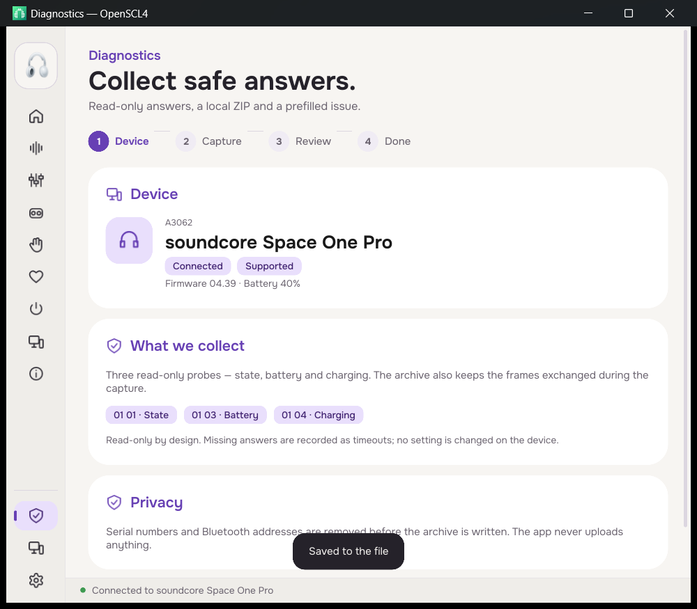

The same page at the 800×700 minimum window: the sidebar is compact (68 px),
the diagnostics cards are one column and no content is clipped horizontally;
**Start capture** stays reachable by scrolling. This is the adaptive check
described below.

### Live A3062 acceptance captures (ticket 05, 2026-11-23)

These three captures are from the finished build during the **real-device**
acceptance run on a paired soundcore Space One Pro (A3062, firmware 04.39,
battery 30 % during the run), connected over Windows RFCOMM through Add Device
with Demo mode off. They document the current build's real state; no Bluetooth
address or serial number is visible. The run behind them is recorded in
`.scratch/windows-complete/issues/05-live-acceptance.md`.

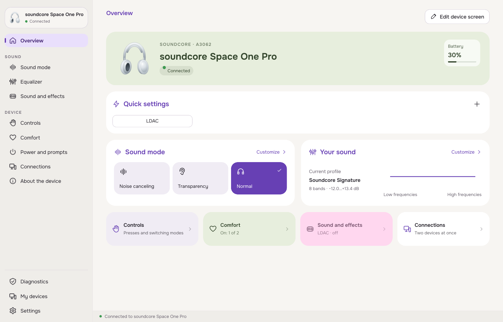

The real **Overview**: the hero shows “SOUNDCORE · A3062”, the device name, the
connected badge and the single-battery tile at the device's 30 %; Quick settings
holds the saved LDAC chip; the Sound mode panel reports the device's current
mode (Normal) and the Your sound panel its profile (Soundcore Signature, 8 bands,
−12.0…+13.4 dB); the four shortcut cards are the Standard layout. This fills the
gap of having no A3062 Overview capture from the current shell.

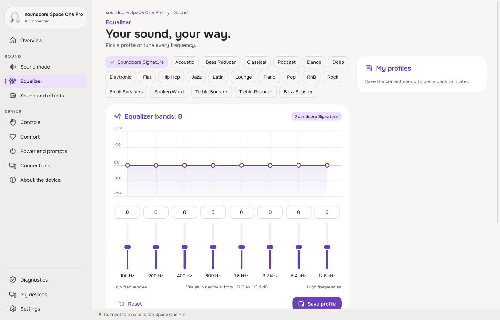

The **Equalizer** page while that device is connected: the 22 catalog preset
chips with Soundcore Signature selected, the eight editable bands and chart at
the re-polled device curve, Reset, Save profile, and the **My profiles** panel.
The acceptance changed presets, typed a custom band, reset, saved/applied a
profile, and imported/exported the transfer JSON, restoring the preset found on
connect afterwards.

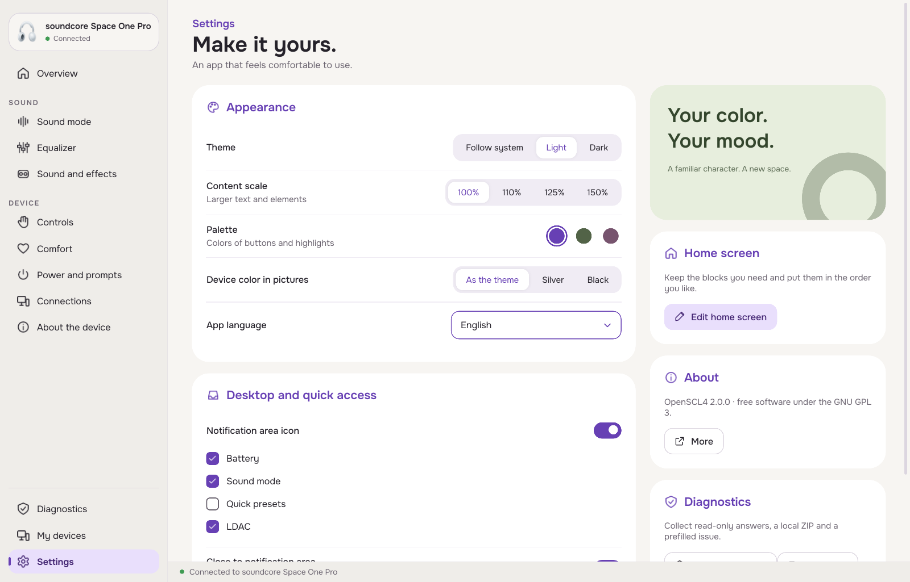

The **Settings** page from the same run, with the real device connected: Light
theme, Purple palette, 100 % content scale (100/110/125/150 %), As the theme
device color, English language, the notification-area icon and its sections, and
Quick presets off. The one-earbud badge switch and the sound-mode view choice
are absent because the A3062 is a single-battery, three-mode device. The run
verified these choices apply immediately, survive a quit and relaunch, and that
the tray icon's tooltip reads “OpenSCL4 · soundcore Space One Pro” over
“Battery 30 %” while connected.

### Live A3954 acceptance captures (ticket 04, 2026-11-23)

These five captures are from the finished build during the **real-device**
acceptance run on the paired soundcore Liberty 4 Pro (A3954, firmware 04.29,
case firmware 01.58; left/right/case batteries 69/69/80 % during the captures),
connected over Windows RFCOMM through Add Device with Demo mode off. They show
the pages ticket 04 covers; no Bluetooth address or serial number appears on any
page or capture. The protocol run behind them (the ignored
`manual_a3954_settings` test) wrote, re-polled and restored every supported
control; the run is recorded in
`.scratch/a3954-settings/issues/04-live-acceptance.md`.

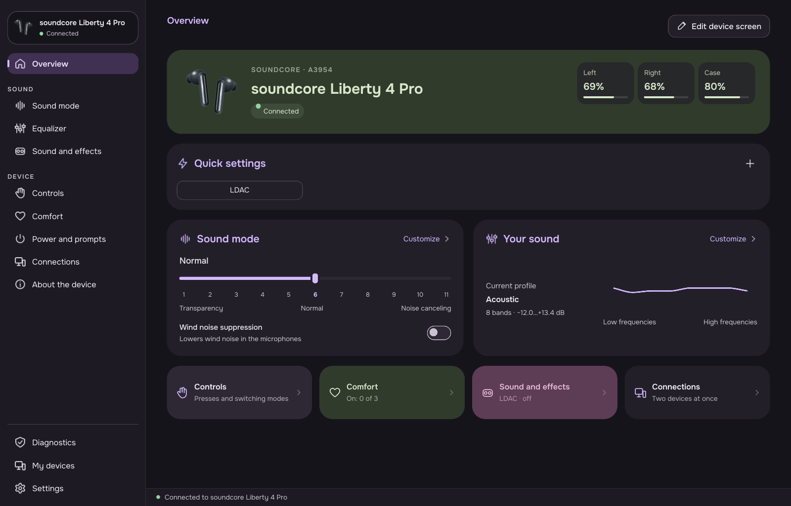

The real **Overview**: the hero shows “SOUNDCORE · A3954”, the device name, the
connected badge and the left/right/case battery tiles (69/69/80 %). Quick
settings holds the saved LDAC chip; the Sound mode panel shows the device's
1–11 scale at position 6 (Normal) with wind-noise suppression off; the Your
sound panel shows the device's Acoustic preset and its eight visible bands; the
shortcuts are the four A3954 pages. These captures were taken during ticket 04;
the later ticket-05 review run used the same build path and found the same
pages, so no UI capture was repeated. In airplane mode the real device reports
an unmeasured slider byte, so the controller hides the scale page and the
Overview's sound-mode block while every other page stays; that state is covered
by a unit regression rather than a capture because a second real device state
would require changing the earbuds' mode.

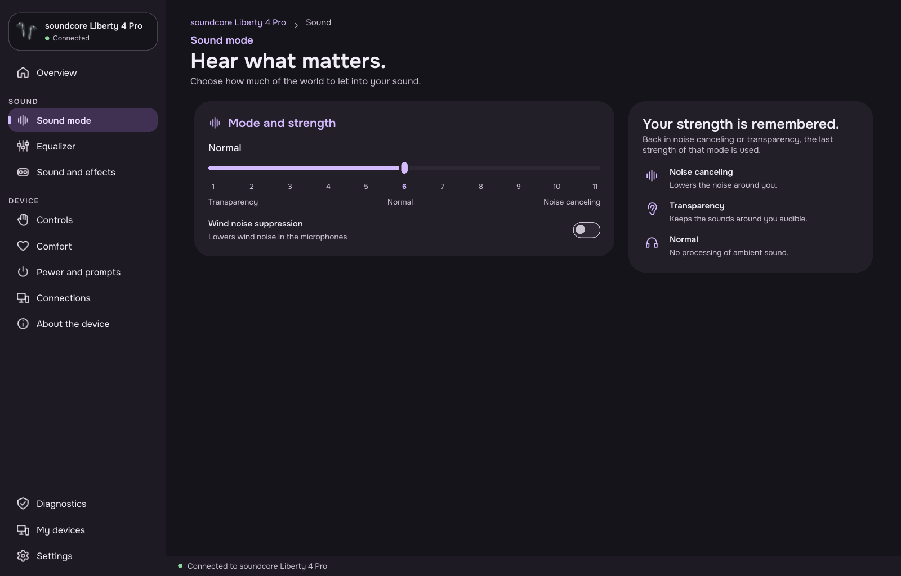

The **Sound mode** page: the 1–11 scale at the device's position 6, the
Transparency/Normal/Noise canceling labels, the per-position numbers and the
wind-noise suppression toggle. The acceptance wrote positions 1, 6 and 11 plus
the wind toggle, re-polling after each and restoring the connect position.

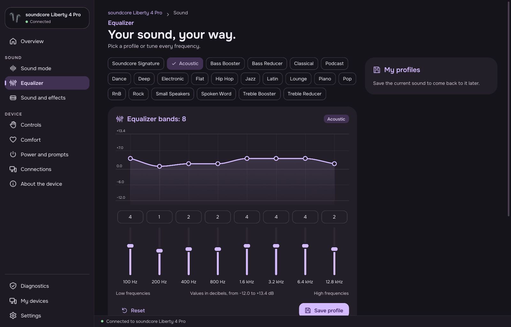

The **Equalizer** page: the A3954's own 22-preset catalog with Acoustic selected
and the device's eight visible bands (4, 1, 2, 2, 4, 4, 4, 2 dB). The ticket-04
acceptance changed the preset to Rock and restored Acoustic. The ticket-05
review run additionally wrote a custom curve that differed from the connect
curve, re-polled it as the custom id `0xFEFE` with the written visible bands,
then restored the connect preset and re-polled it; the real device reports its
left equalizer channel and no right channel, and the 114-byte bodies keep the
HearID block verbatim. HearID editing is out of scope and was not done.

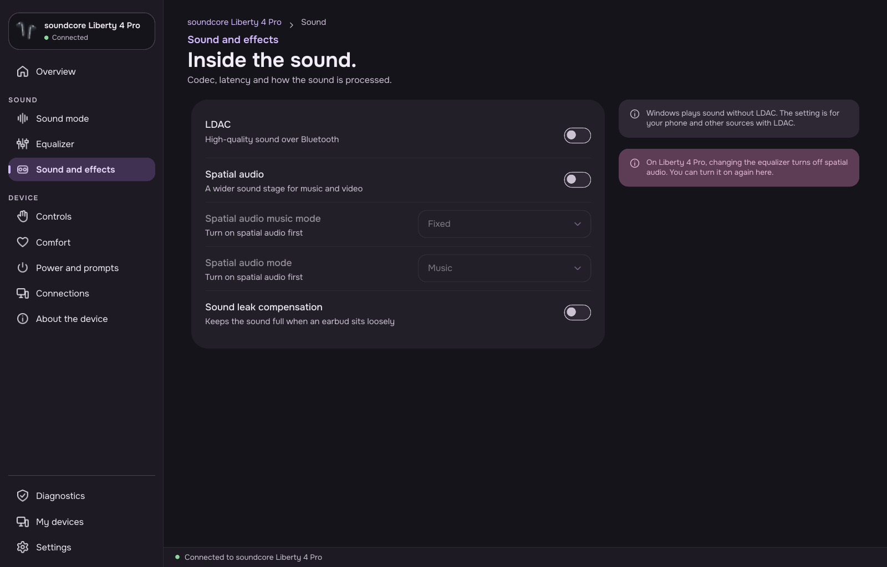

The **Sound and effects** page: LDAC, Spatial audio with the music-mode and
effect-mode selects disabled with the device reason “Turn on spatial audio
first”, sound leak compensation, and the page note that changing the equalizer
turns spatial audio off. The acceptance toggled LDAC and spatial audio (enable,
music mode, effect mode) and restored each. The English reason is controller
data and is localized by the view (`LocalizedText.setting-reason`); the Russian
UI shows “Сначала включите пространственный звук”.

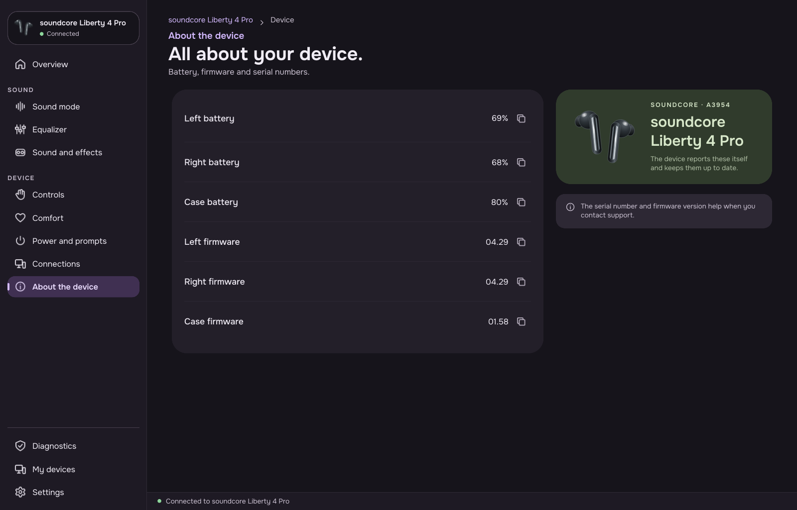

The **About the device** page: left/right/case battery (69/69/80 %), both earbud
firmwares 04.29 and the case firmware 01.58. The serial row is deliberately
absent; the capture carries no address or serial.

### Live A3954 buttons/case acceptance captures (ticket 03, 2026-11-23)

These three captures are from the finished build during the **real-device**
acceptance run on the paired soundcore Liberty 4 Pro (A3954, firmware 04.29,
case firmware 01.58; case battery 60 % during the run), connected over Windows
RFCOMM through Add Device with Demo mode off. They show the buttons/case pages;
no Bluetooth address or serial number appears on any page or capture. The
protocol run behind them (the ignored `manual_a3954_buttons_and_case` test)
changed and restored all twelve gesture action bytes, toggled each case-screen
feature and walked the case language, re-polling after every write to a
byte-for-byte match; the run is recorded in
`.scratch/a3954-buttons-case/issues/03-live-acceptance.md`. The device reported
its TWS link down during the run (only the left earbud active), so the Controls
page shows the disconnected-state actions the device actually applies.

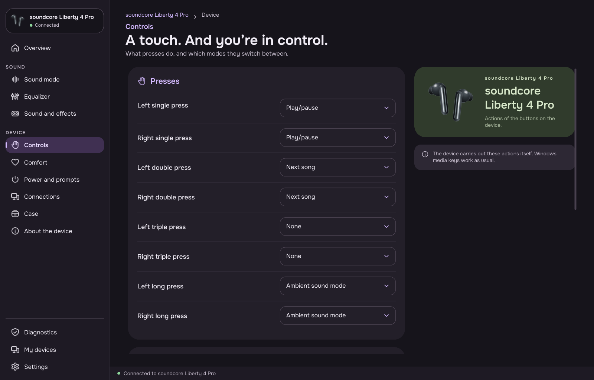

The real **Controls** page: the Presses panel with all eight press rows and the
device-reported actions (singles Play/pause, doubles Next song, triples None,
longs Ambient sound mode).

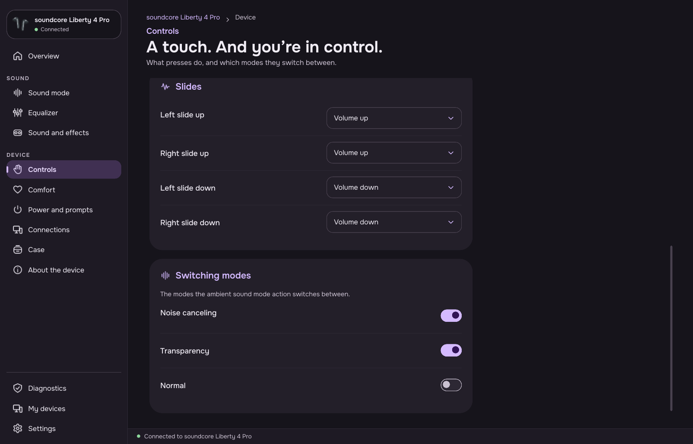

The same page scrolled to the **Slides** panel (left/right slide up Volume up,
left/right slide down Volume down) and the **Switching modes** panel with the
device's ambient cycle (Noise canceling and Transparency on, Normal off).

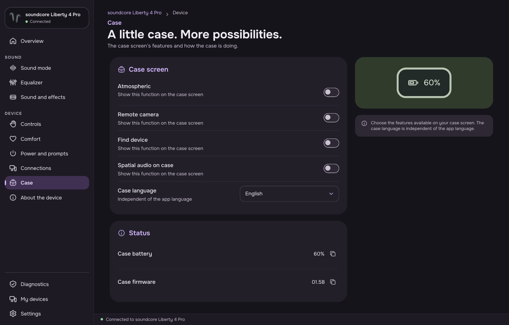

The real **Case** page: the four measured case-screen feature toggles (all off),
the case language (English) and the read-only Status panel with case battery
60 % and case firmware 01.58. The case serial never reaches the page.

## Adaptive layout checks

Every UI change is checked at the real window breakpoints, not only at the
preferred size:

- **800×700** — the minimum window; sidebar is compact (68 px), the content is
  one column, and the page still has no horizontal scroll or clipped controls.
- **1030×760** — the compact-sidebar boundary; labels may collapse but every
  icon still has an accessible name and the active page stays obvious.
- **1280×820** — the preferred window; two-column pages keep their aside and
  panels do not stretch past their content.
- **1440×900** — wide layout; the aside stays aligned to the top and no panel
  drifts into empty space.

Also check Windows display scaling at 100%, 125% and 150%. A page passes when
there is no horizontal overflow, no truncated label without an ellipsis or
tooltip, dialogs fit the window, and all primary actions remain reachable by
mouse and keyboard. Keep a screenshot for each width when the change is visual.

## Run

```powershell
cd desktop
cargo run
```

Closing the window keeps OpenSCL4 running in the notification area while the
icon is shown and **Close to notification area** is on; the tray's **Open** item
(or a left click on the icon) brings the window back, and **Quit** in the tray or
on the Settings page ends the program and removes the icon. Starting the
executable again while it runs only asks the running copy to show its window.
The tray and desktop switches are restored from `desktop-preferences.json` on
the next run. The app needs the earbuds paired in Windows (pairing itself is done
in Windows settings) and never changes the pairing.

## License and attribution

GPL-3.0-or-later. The vendored files keep their upstream copyright; see
`ui/SOURCE.md` and the root `NOTICE`. The protocol command/response and
equalizer-preset data adapted from OpenSCL4 is attributed in the root `NOTICE`
too. Changes to vendored files are recorded in the commit that makes them.
